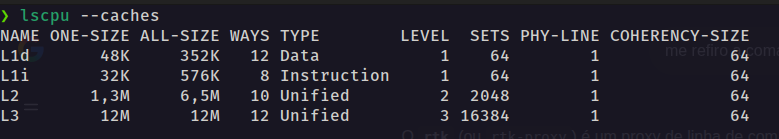
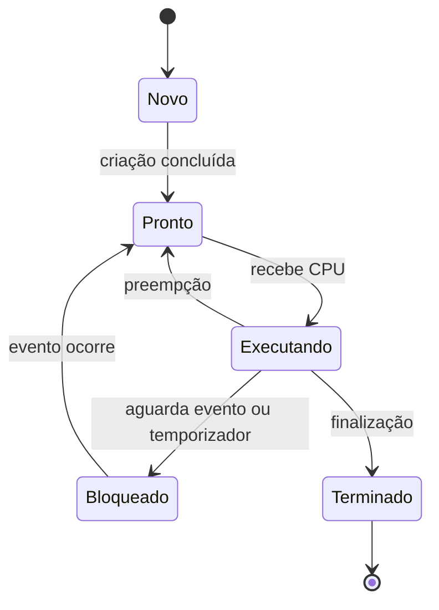
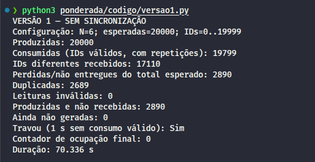
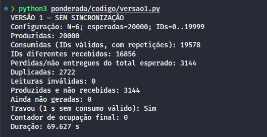
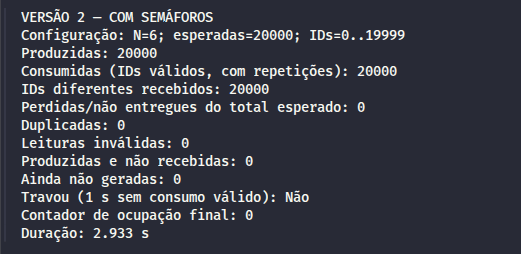
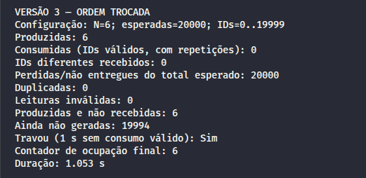
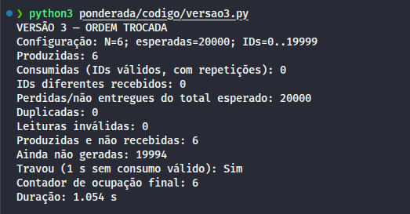
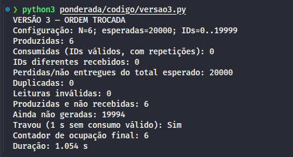
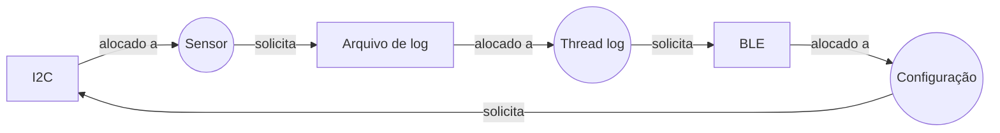

Leunam Sousa de Jesus | D1 = 6 | D2 = 8 | N = 6

# Ponderada CC08: Tato

## Parâmetros individuais

Contagem das letras e D1, D2 e N:

| Parte do nome | Quantidade de letras |
|---|---:|
| Leunam | 6 |
| Sousa | 5 |
| de | 2 |
| Jesus | 5 |
| **Total** | **18** |

Variáveis base:
$$
\begin{aligned}
&D1 = 6 \\
&D2 = 8
\end{aligned}
$$

Amostras que o buffer pode armazenar ao mesmo tempo:
$$
\begin{aligned}
N &= 3 + (D2 \bmod 5) \\
  &= 3 + (8 \bmod 5) \\
  &= 3 + 3 \\
  &= 6 \text{ posições}
\end{aligned}
$$

Quantidade de instruções executadas por amostra:

$$
\begin{aligned}
IC &= 100.000 + 20.000 \times D2 \\
   &= 100.000 + 20.000 \times 8 \\
   &= 100.000 + 160.000 \\
   &= 260.000 \text{ instruções por amostra}
\end{aligned}
$$

Taxa de faltas na cache L1 da plataforma V:

$$
\begin{aligned}
m &= 3\% + 0{,}5\% \times D1 \\
  &= 3\% + 0{,}5\% \times 6 \\
  &= 3\% + 3\% \\
  &= 6\%
\end{aligned}
$$

## Parte A: O problema técnico

### A1: Arquitetura e memória

#### Plataforma H:

A plataforma H possui clock de 48 MHz e CPI de 1,5 ciclo por instrução. Para processar uma amostra, o programa executa 260.000 instruções.

**Ciclos por amostra:**

$$
\begin{aligned}
C &= IC \times CPI \\
  &= 260.000 \times 1{,}5 \\
  &= 260.000 + 130.000 \\
  &= 390.000 \text{ ciclos por amostra}
\end{aligned}
$$

**Frequência em ciclos por segundo:**

$$
\begin{aligned}
f &= 48 \text{ MHz} \\
  &= 48 \times 1.000.000 \text{ ciclos/s} \\
  &= 48.000.000 \text{ ciclos/s}
\end{aligned}
$$

**Tempo por amostra:**

$$
\begin{aligned}
T_H &= \frac{IC \times CPI}{f} \\
    &= \frac{260.000 \times 1{,}5}{48.000.000} \\
    &= \frac{390.000}{48.000.000} \\
    &= 0{,}008125 \text{ s}
\end{aligned}
$$

**Conversão para milissegundos:**

$$
\begin{aligned}
T_H &= 0{,}008125 \text{ s} \\
    &= 0{,}008125 \times 1.000 \text{ ms} \\
    &= 8{,}125 \text{ ms}
\end{aligned}
$$

**Conclusão:** a plataforma H não atende ao requisito de processar cada amostra em até 5 ms, pois o tempo calculado é de 8,125 ms por amostra, superior ao limite estabelecido.

#### Plataforma V:

**Tempo médio de acesso à memória (AMAT):**

Com taxa de faltas de 6% (0,06), tempo de acerto de 1 ciclo e penalidade adicional de 120 ciclos por falta, temos:

$$
\begin{aligned}
AMAT &= t_{\text{acerto}} + m \times P_{\text{falta}} \\
     &= 1 + 0{,}06 \times 120 \\
     &= 1 + 7{,}2 \\
     &= 8{,}2 \text{ ciclos por acesso}
\end{aligned}
$$

Assim, considerando os acertos e as faltas, cada acesso à memória custa em média 8,2 ciclos no modelo do exercício.

**CPI efetivo:**

O CPI base da plataforma V é de 1,0 ciclo por instrução, sem faltas na cache. Como são feitos, em média, 1,3 acessos à memória por instrução, acrescentamos as esperas causadas pelas faltas:

$$
\begin{aligned}
CPI_{\text{efetivo}} &= CPI_{\text{base}} + (1{,}3 \times m \times P_{\text{falta}}) \\
                    &= 1{,}0 + (1{,}3 \times 0{,}06 \times 120) \\
                    &= 1{,}0 + 9{,}36 \\
                    &= 10{,}36 \text{ ciclos por instrução}
\end{aligned}
$$

As faltas acrescentam, em média, 9,36 ciclos por instrução. Somamos apenas essas penalidades ao CPI base, que já considera a execução com acertos na cache.

**Frequência em ciclos por segundo:**

$$
\begin{aligned}
f &= 1{,}2 \text{ GHz} \\
  &= 1{,}2 \times 1.000.000.000 \text{ ciclos/s} \\
  &= 1.200.000.000 \text{ ciclos/s}
\end{aligned}
$$

**Tempo de processamento por amostra:**

Multiplicamos a quantidade de instruções pelo CPI efetivo para obter o total de ciclos por amostra. Depois, dividimos esse total pela frequência:

$$
\begin{aligned}
T_V &= \frac{IC \times CPI_{\text{efetivo}}}{f} \\
    &= \frac{260.000 \times 10{,}36}{1.200.000.000} \\
    &= \frac{2.693.600}{1.200.000.000} \text{ s} \\
    &\approx 0{,}002244667 \text{ s} \\
    &\approx 2{,}244667 \text{ ms}
\end{aligned}
$$

Esse tempo já inclui as esperas médias pelas faltas na cache, pois foi calculado com o CPI efetivo.

**Tempo com atraso do sistema operacional:**

Para o pior caso considerado no exercício, somamos ao tempo de processamento o atraso máximo de 3 ms causado pelo Linux:

$$
\begin{aligned}
T_{V+SO} &= T_V + T_{\text{SO máximo}} \\
         &\approx 2{,}244667 \text{ ms} + 3 \text{ ms} \\
         &\approx 5{,}244667 \text{ ms}
\end{aligned}
$$

**Conclusão:** a plataforma V não atende ao prazo na condição calculada. O processamento isolado fica abaixo de 5 ms, mas o total com o atraso máximo do SO chega a aproximadamente 5,244667 ms, ultrapassando o limite por amostra. O requisito precisa ser cumprido também quando ocorre esse atraso.

#### Plataforma H com DSP:

**Speedup global pela Lei de Amdahl:**

O filtro representa 60% do tempo original de processamento e fica cinco vezes mais rápido com o DSP. Os outros 40% permanecem com a mesma duração. Assim, usamos a Lei de Amdahl com fração acelerada de p = 0,6 e aceleração local de s = 5:

$$
\begin{aligned}
S &= \frac{1}{(1-p) + \frac{p}{s}} \\
  &= \frac{1}{(1-0{,}6) + \frac{0{,}6}{5}} \\
  &= \frac{1}{0{,}4 + 0{,}12} \\
  &= \frac{1}{0{,}52} \\
  &\approx 1{,}923
\end{aligned}
$$

O speedup global é de aproximadamente 1,923 vez. O processamento completo passa a levar 52% do tempo original, pois somente a parcela do filtro é acelerada em cinco vezes.

**Novo tempo por amostra:**

Aplicamos a fração de tempo restante ao tempo original de H. Usamos o fator exato de 0,52 para evitar o arredondamento do speedup:

$$
\begin{aligned}
T_{H+DSP} &= T_H \times \left[(1-p) + \frac{p}{s}\right] \\
          &= 8{,}125 \times \left[0{,}4 + \frac{0{,}6}{5}\right] \text{ ms} \\
          &= 8{,}125 \times 0{,}52 \text{ ms} \\
          &= 4{,}225 \text{ ms}
\end{aligned}
$$

A margem em relação ao prazo de 5 ms é:

$$
\text{Margem} = 5 - 4{,}225 = 0{,}775 \text{ ms}
$$

**Conclusão:** a plataforma H com DSP atende ao requisito no modelo do exercício, pois processa cada amostra em 4,225 ms, abaixo do limite de 5 ms, com margem de 0,775 ms.

#### Cache e gargalo de Von Neumann:

Na V, instruções e dados dividem o acesso à DRAM, lenta frente à CPU.<br>
Essa disputa gera o gargalo de Von Neumann; a cache reduz acessos e esperas.<br>
Na H, há caminhos separados e SRAM interna de um ciclo, dispensando cache.<br>
Isso depende da memória usada: uma arquitetura Harvard também pode ter cache.

#### Caches do computador:

Consulta realizada no Linux com `rtk proxy lscpu --caches`:



A L1 do meu computador é dividida em L1d, dedicada aos dados, e L1i, dedicada às instruções. Já as caches L2 e L3 aparecem como Unified, ou seja, armazenam tanto instruções quanto dados.

A organização observada é típica de Harvard modificada: há separação entre instruções e dados no primeiro nível de cache e unificação nos níveis seguintes. Por isso, a existência de L1d e L1i separadas não caracteriza o computador como Harvard puro.

### A2: Pipeline

O trecho analisado é:

```asm
lw   x5, 0(x10)     # 1: lê a amostra nova
add  x6, x6, x5     # 2: acrescenta a amostra nova à soma
lw   x7, 0(x11)     # 3: lê a amostra mais antiga
sub  x6, x6, x7     # 4: retira a amostra antiga da soma
sw   x6, 0(x12)     # 5: grava a soma atualizada
addi x10, x10, 4    # 6: avança o ponteiro da amostra nova
addi x11, x11, 4    # 7: avança o ponteiro da amostra antiga
```

**Dependências RAW:**

Considerando as dependências diretas dentro de uma execução do trecho, temos:

| Instrução produtora | Instrução consumidora | Registrador | Valor usado |
|---|---|---|---|
| 1: `lw` | 2: `add` | x5 | Amostra nova que será acrescentada à soma. |
| 2: `add` | 4: `sub` | x6 | Soma já acrescida da amostra nova. |
| 3: `lw` | 4: `sub` | x7 | Amostra antiga que será retirada da soma. |
| 4: `sub` | 5: `sw` | x6 | Soma final que será gravada na memória. |

O valor de x6 produzido pela instrução 2 é usado pela 4. A instrução 4 atualiza x6 novamente, e é essa versão que a instrução 5 usa. As instruções 6 e 7 atualizam os ponteiros para a próxima iteração, sem produzir valores lidos por instruções posteriores dentro deste trecho.

**Pipeline sem forwarding:**

Considerei um ciclo por estágio, execução na ordem original e acessos a instruções e dados sem conflitos estruturais adicionais. A escrita no banco de registradores ocorre na primeira metade do ciclo e a leitura na segunda, permitindo WB e ID usarem o mesmo registrador no mesmo ciclo.

```text
Ciclo           1   2   3   4   5   6   7   8   9  10  11  12  13  14  15  16  17
1 lw x5        IF  ID  EX MEM  WB   .   .   .   .   .   .   .   .   .   .   .   .
2 add x6        .  IF ID* ID*  ID  EX MEM  WB   .   .   .   .   .   .   .   .   .
3 lw x7         .   .  IF IF* IF*  ID  EX MEM  WB   .   .   .   .   .   .   .   .
4 sub x6        .   .   .   .   .  IF ID* ID*  ID  EX MEM  WB   .   .   .   .   .
5 sw x6         .   .   .   .   .   .  IF IF* IF* ID* ID*  ID  EX MEM   .   .   .
6 addi x10      .   .   .   .   .   .   .   .   .  IF IF* IF*  ID  EX MEM  WB   .
7 addi x11      .   .   .   .   .   .   .   .   .   .   .   .  IF  ID  EX MEM  WB
```

`ID*` indica espera pelo valor necessário; `IF*` indica uma instrução retida na entrada porque ID está bloqueado; `.` indica ausência da instrução naquele ciclo. O `sw` grava na memória em MEM e não escreve um registrador em WB. Nas instruções aritméticas, a passagem por MEM não realiza acesso à memória de dados.

As esperas adicionais são:

| Dependência | Ciclos de espera em ID | Ciclo em que a leitura é liberada | Bolhas |
|---|---|---:|---:|
| 1 → 2, por x5 | 3 e 4 | 5 | 2 |
| 3 → 4, por x7 | 7 e 8 | 9 | 2 |
| 4 → 5, por x6 | 10 e 11 | 12 | 2 |

A dependência 2 → 4 não acrescenta espera: x6 é escrito no ciclo 8, e o `sub` já precisa aguardar até o ciclo 9 para ler x7. As retenções em IF são consequências dessas mesmas esperas e não são contadas novamente como bolhas.

O total, do primeiro IF ao último WB, é:

$$
\begin{aligned}
C_{\text{sem forwarding}} &= 7 + (5-1) + (2+2+2) \\
                         &= 7 + 4 + 6 \\
                         &= 17 \text{ ciclos}
\end{aligned}
$$

São sete instruções, quatro ciclos adicionais do preenchimento/esvaziamento do pipeline de cinco estágios e seis bolhas.

**Pipeline com forwarding:**

Mantive as demais premissas e considerei forwarding completo, incluindo o encaminhamento do dado que o `sw` grava. O diagrama fica:

```text
Ciclo           1   2   3   4   5   6   7   8   9  10  11  12  13
1 lw x5        IF  ID  EX MEM  WB   .   .   .   .   .   .   .   .
2 add x6        .  IF ID*  ID  EX MEM  WB   .   .   .   .   .   .
3 lw x7         .   .  IF IF*  ID  EX MEM  WB   .   .   .   .   .
4 sub x6        .   .   .   .  IF ID*  ID  EX MEM  WB   .   .   .
5 sw x6         .   .   .   .   .  IF IF*  ID  EX MEM   .   .   .
6 addi x10      .   .   .   .   .   .   .  IF  ID  EX MEM  WB   .
7 addi x11      .   .   .   .   .   .   .   .  IF  ID  EX MEM  WB
```

A legenda é a mesma do diagrama anterior. Com forwarding, a liberação de ID não exige que todo operando atualizado já esteja no banco de registradores: ele pode ser encaminhado à etapa em que será usado.

Restam duas bolhas, nas dependências load-use 1 → 2 por x5 e 3 → 4 por x7. O dado de um `lw` só fica disponível ao final de MEM, enquanto a instrução imediatamente seguinte precisaria dele em EX naquele mesmo ciclo. Por isso, cada um desses casos exige uma espera de um ciclo: o `add` executa EX no ciclo 5 e o `sub` no ciclo 8.

A dependência 2 → 4 não acrescenta espera: o `add` escreve x6 em WB no ciclo 7, e o `sub` pode ler esse valor em ID no mesmo ciclo. Na dependência 4 → 5, o resultado do `sub` é encaminhado ao `sw`, sem aguardar a escrita no banco de registradores.

O total, do primeiro IF ao último WB, é:

$$
\begin{aligned}
C_{\text{com forwarding}} &= 7 + (5-1) + (1+1) \\
                         &= 7 + 4 + 2 \\
                         &= 13 \text{ ciclos}
\end{aligned}
$$

**Reordenação para eliminar as bolhas com forwarding:**

Antecipei a instrução 3, que carrega a amostra antiga, colocando-a entre a carga da amostra nova e o `add`. A nova ordem, usando a numeração original, é 1, 3, 2, 4, 5, 6, 7:

```asm
lw   x5, 0(x10)     # 1: lê a amostra nova
lw   x7, 0(x11)     # 3: lê a amostra antiga
add  x6, x6, x5     # 2: acrescenta a nova à soma
sub  x6, x6, x7     # 4: retira a antiga da soma
sw   x6, 0(x12)     # 5: grava a soma atualizada
addi x10, x10, 4    # 6: avança o ponteiro da amostra nova
addi x11, x11, 4    # 7: avança o ponteiro da amostra antiga
```

A instrução 3 usa x11 e escreve x7, enquanto a instrução 2 usa x6 e x5 e escreve x6. Assim, antecipar essa carga não altera os valores usados pelo `add`. A soma continua sendo atualizada na mesma sequência, e os incrementos dos ponteiros permanecem depois das respectivas cargas, preservando os endereços acessados.

Agora há uma instrução independente entre cada `lw` e o uso do dado carregado. A instrução 1 termina MEM no ciclo 4, e o `add` usa x5 em EX no ciclo 5. A instrução 3 termina MEM no ciclo 5, e o `sub` usa x7 em EX no ciclo 6. O forwarding também atende às dependências do resultado do `add` para o `sub` e do `sub` para o dado gravado pelo `sw`, sem esperas adicionais.

Mantendo o forwarding completo, o trecho não precisa de bolhas:

$$
\begin{aligned}
C_{\text{reordenado}} &= 7 + (5-1) + 0 \\
                     &= 7 + 4 \\
                     &= 11 \text{ ciclos}
\end{aligned}
$$

| Organização | Bolhas | Total de ciclos |
|---|---:|---:|
| Ordem original, sem forwarding | 6 | 17 |
| Ordem original, com forwarding | 2 | 13 |
| Ordem reordenada, com forwarding | 0 | 11 |

### A3: Processos e threads

**Organização proposta para a plataforma V:**

| Processo | Threads e tarefas |
|---|---|
| Controle da pulseira | Três threads: leitura do sensor, processamento da amostra e acionamento do motor de vibração. |
| Comunicação | Uma thread responsável pelo BLE, envio de logs e recebimento de comandos de configuração. |

As threads de controle trabalham sobre as mesmas amostras e resultados. Mantê-las no mesmo processo permite compartilhar esses dados em memória, com sincronização para coordenar os acessos aos buffers.

O BLE fica em outro processo por receber informações externas. A separação cria uma fronteira de memória e reduz a possibilidade de uma falha na comunicação atingir diretamente os dados do controle.

Os processos trocam mensagens por IPC. O controle disponibiliza cópias dos logs em uma fila de capacidade limitada, sem aguardar a transmissão por Bluetooth. Se a fila estiver cheia, a política proposta é descartar o log mais antigo e registrar o descarte. Assim, uma conexão lenta não mantém o caminho de vibração esperando pelo envio dos logs. Os comandos de configuração também chegam ao controle por mensagens entre os processos.

**Criação, troca de contexto e sincronização:**

As threads compartilham a memória de dados do processo, mas cada uma mantém seu próprio contexto de execução, incluindo os registradores e a pilha de chamadas. Criar uma thread tende a ser mais leve que criar outro processo, pois ela aproveita o espaço de memória e os recursos já existentes.

Na troca de contexto, o sistema salva o estado da execução pausada e restaura o estado da próxima. Entre threads do mesmo processo, o espaço de memória permanece o mesmo. Entre processos, também é necessário considerar a mudança do contexto de memória. Por isso, agrupar as tarefas de controle facilita a comunicação e evita criar fronteiras de memória entre etapas que usam as mesmas amostras.

Os processos e threads são criados na inicialização e permanecem durante o funcionamento, evitando esse custo a cada amostra. O processo separado de BLE e a comunicação por IPC acrescentam custos, aceitos para obter isolamento. O compartilhamento entre as threads também exige sincronização, que consome recursos e pode gerar esperas; aumentar o número de threads não melhora automaticamente o desempenho.

**Segurança do módulo BLE:**

Se o BLE fosse uma thread do processo de controle, uma exploração que permitisse executar código teria acesso à memória compartilhada e às permissões desse processo. Isso poderia atingir diretamente amostras, configurações e dados usados para comandar a vibração.

Como processo separado, a exploração fica inicialmente limitada ao espaço de memória e às permissões do BLE. Essa fronteira reduz o alcance da falha, mas não impede comandos perigosos por IPC nem o consumo excessivo de recursos compartilhados do sistema. Por isso, a proposta inclui:

- Permissões mínimas para o BLE, sem controle direto do sensor e do motor.
- Validação do formato, tamanho, tipo e valores das mensagens antes de o controle aplicar uma configuração.
- Limites de CPU, memória e quantidade de mensagens, reduzindo o risco de a comunicação prejudicar os recursos necessários ao controle.

O objetivo é restringir o impacto de uma falha do BLE à comunicação e aos logs, preservando o controle dos alertas táteis. O isolamento de memória precisa ser acompanhado dessas restrições e validações.

**Diagrama de estados:**



Na proposta, a thread do sensor tende a passar a maior parte do tempo bloqueada, aguardando um temporizador ou evento para a próxima leitura. As amostras chegam a cada 10 ms; considerando uma leitura breve, a thread executa a coleta e volta a esperar, liberando a CPU para outras tarefas.

Quando o evento ocorre, ela passa para Pronto e aguarda receber a CPU para executar. Pronto significa espera por CPU; Bloqueado significa espera por um evento necessário para continuar. O bloqueio da thread do sensor não impede que outras threads do mesmo processo executem.

### A4: Código com semáforos

**Configuração do experimento:**

O experimento usa Python 3 com threading, uma thread produtora e uma consumidora, um buffer circular de N = 6 posições e 20.000 amostras identificadas de 0 a 19.999.

O `sleep(0)` foi mantido entre a leitura e a escrita do contador nas três versões; nas versões 2 e 3, esse trecho fica protegido por mutex. Não foi acrescentado atraso inicial controlado para forçar o escalonamento.

**Critério de contagem dos resultados:**

Consumidas é a quantidade de IDs válidos recebidos, incluindo repetições. Para detectar erros, contamos também os IDs diferentes que chegaram:

$$
\begin{aligned}
\text{Duplicadas} &= \text{Consumidas} - \text{IDs diferentes recebidos} \\
\text{Perdidas/não entregues} &= 20.000 - \text{IDs diferentes recebidos}
\end{aligned}
$$

A coluna de perdidas/não entregues representa os IDs esperados que não chegaram ao consumidor. Em uma execução interrompida, esse número pode incluir amostras ainda não geradas; por isso, também registramos quantas foram produzidas. Leituras de posições sem um ID válido são contabilizadas separadamente e não entram em consumidas. Travamento é registrado quando o consumidor fica um segundo sem receber uma amostra válida.

**Versão 1: região crítica e condição de corrida:**

A região crítica envolve o acesso ao buffer e a atualização do estado que representa sua ocupação. A atualização do contador passa por leitura, cálculo e escrita. Sem proteção, as duas threads podem ler o mesmo valor antes que qualquer uma conclua a atualização. O `time.sleep(0)` entre a leitura e a escrita favorece essa intercalação.

Por exemplo, com ocupação inicial de 3, o produtor e o consumidor podem guardar esse mesmo valor temporariamente. O produtor insere uma amostra e escreve 4; o consumidor retira uma amostra, mas usa sua leitura antiga de 3 e escreve 2. O correto seria continuar com 3 amostras. A última escrita apaga o efeito da atualização anterior, e o contador deixa de representar o conteúdo real do buffer.

Essa inconsistência pode permitir sobrescrever uma amostra ainda não consumida ou ler conteúdo antigo, causando perdas, duplicações ou falta de progresso. Quando não pode inserir ou retirar, cada thread usa espera ocupada, repetindo a verificação do contador.

**Versão 2: papel dos semáforos:**

| Semáforo | Valor inicial | O que garante |
|---|---:|---|
| vazio | 6 | Reserva de vagas para o produtor; sem uma vaga disponível, ele aguarda bloqueado. |
| cheio | 0 | Disponibilidade de amostras para o consumidor; sem item disponível, ele aguarda bloqueado. |
| mutex | 1 | Exclusão mútua no acesso ao buffer e ao estado de ocupação, permitindo uma thread por vez na região crítica. |

As operações de aquisição e liberação do semáforo controlam suas permissões de forma indivisível. Vazio e cheio coordenam a disponibilidade de vagas e itens; mutex impede que as atualizações da região crítica sejam intercaladas pelas duas threads.

| Passo | Produtor | Consumidor |
|---|---|---|
| 1 | Adquire vazio e reserva uma vaga. | Adquire cheio e reserva um item. |
| 2 | Adquire mutex. | Adquire mutex. |
| 3 | Insere e atualiza índice e ocupação. | Retira e atualiza índice e ocupação. |
| 4 | Libera mutex. | Libera mutex. |
| 5 | Libera cheio, sinalizando um item. | Libera vazio, sinalizando uma vaga. |

A espera por disponibilidade ocorre antes de adquirir mutex, deixando a região crítica livre enquanto a thread aguarda uma vaga ou item. O `sleep(0)` entre ler e escrever a ocupação foi mantido dentro da região protegida; mesmo com uma troca de execução nesse intervalo, a outra thread precisa aguardar mutex antes de modificar o estado.

**Versão 3: ordem trocada:**

Na versão 3, o produtor adquire mutex antes de vazio. O consumidor mantém a ordem cheio e depois mutex, e os demais parâmetros e operações da versão 2 são preservados.

Se o buffer estiver cheio, o produtor pode adquirir mutex e ficar esperando uma vaga em vazio, mantendo a exclusão. O consumidor precisa de mutex para retirar uma amostra e liberar essa vaga. Assim, o produtor espera uma ação do consumidor, enquanto o consumidor espera o mutex que o produtor mantém. Essa espera circular causa deadlock, mesmo com os acessos protegidos contra condições de corrida.

A supervisão registra falta de progresso após um segundo sem consumo. As esperas nos semáforos têm intervalos bloqueantes para consultar o sinal de encerramento, mantendo a primeira permissão enquanto aguardam a segunda. Somente após a supervisão pedir a parada, as reservas são devolvidas para encerrar as threads; o algoritmo não é corrigido para continuar a produção e o consumo.

**Resultados das execuções realizadas:**

| Versão | Execução | Produzidas | Consumidas | Perdidas/não entregues | Duplicadas | Leituras inválidas | Travou? |
|---|---:|---:|---:|---:|---:|---:|---|
| 1 | 1 | 20.000 | 19.799 | 2.890 | 2.689 | 0 | Sim |
| 1 | 2 | 20.000 | 19.871 | 2.835 | 2.706 | 0 | Sim |
| 1 | 3 | 20.000 | 19.578 | 3.144 | 2.722 | 0 | Sim |
| 2 | 1 | 20.000 | 20.000 | 0 | 0 | 0 | Não |
| 2 | 2 | 20.000 | 20.000 | 0 | 0 | 0 | Não |
| 2 | 3 | 20.000 | 20.000 | 0 | 0 | 0 | Não |
| 3 | 1 | 6 | 0 | 20.000 | 0 | 0 | Sim |
| 3 | 2 | 6 | 0 | 20.000 | 0 | 0 | Sim |
| 3 | 3 | 6 | 0 | 20.000 | 0 | 0 | Sim |

Nas três rodadas da versão 1, todas as 20.000 amostras foram produzidas, mas o consumidor recebeu identificadores repetidos e deixou de receber outros. Não houve leituras inválidas; as falhas apareceram como perdas de IDs e duplicações. Todas as execuções foram encerradas pela supervisão após um segundo sem consumo válido.

Nas três rodadas da versão 2, todos os 20.000 IDs chegaram uma única vez, sem leituras inválidas ou travamento. Nessas execuções, a reserva de vagas e itens e a proteção da região crítica mantiveram o fluxo correto entre produtor e consumidor.

Nas três rodadas da versão 3, o produtor gerou seis amostras, o buffer ficou cheio e nenhuma foi consumida. Esse comportamento corresponde ao impasse previsto pela ordem trocada: o produtor pode manter mutex enquanto espera uma vaga, impedindo o consumidor de entrar para retirar uma amostra. A supervisão encerrou os ensaios após um segundo sem consumo. Os 20.000 IDs não entregues incluem seis produzidos e não recebidos e 19.994 que não chegaram a ser gerados. Não houve duplicações porque não ocorreu nenhum recebimento.

**Print da execução 1: versão 1:**



**Print da execução 2: versão 1:**


**Print da execução 3: versão 1:**



**Print da execução 1: versão 2:**


**Print da execução 2: versão 2:**



**Print da execução 3: versão 2:**


**Print da execução 1: versão 3:**



**Print da execução 2: versão 3:**



**Print da execução 3: versão 3:**



Os resultados descrevem as execuções observadas e precisam ser interpretados junto à lógica de cada algoritmo. Três rodadas sem erro, sozinhas, não demonstram correção em todos os escalonamentos. As durações medem o experimento com threads no computador, não o processamento de uma amostra no hardware da pulseira; portanto, não comprovam o prazo de 5 ms analisado na A1.

### A5: Deadlock

**Sequência que leva ao deadlock:**

Considerando uma permissão por recurso e uso exclusivo, uma intercalação possível é:

1. A thread sensor adquire I2C com `P(i2c)`, faz a leitura e é pausada antes de solicitar o log.
2. A thread log adquire o arquivo com `P(log)`, faz sua leitura e é pausada antes de solicitar BLE.
3. A thread configuração adquire o rádio com `P(ble)`, recebe o comando e é pausada antes de solicitar I2C.
4. Sensor executa `P(log)` e fica bloqueada, pois o arquivo está com a thread log. Ela continua mantendo I2C.
5. Log executa `P(ble)` e fica bloqueada, pois o rádio está com configuração. Ela continua mantendo o arquivo de log.
6. Configuração executa `P(i2c)` e fica bloqueada, pois o barramento está com sensor. Ela continua mantendo BLE.

Cada thread mantém seu primeiro recurso enquanto espera o segundo. Como as liberações com `V` aparecem depois da segunda aquisição, nenhuma alcança essas liberações. Forma-se o ciclo de espera sensor → log → configuração → sensor.

**Grafo de alocação no instante do deadlock:**



Os retângulos representam recursos e os círculos representam threads. A seta recurso → thread indica alocação; thread → recurso indica solicitação pendente. Com uma permissão por recurso, o ciclo mostra que cada thread aguarda um recurso mantido por outra, sem conseguir alcançar a liberação.

**Quatro condições necessárias para deadlock:**

| Condição | Como aparece no código |
|---|---|
| Exclusão mútua | I2C, arquivo de log e BLE têm uma permissão cada; uma thread por vez pode manter cada recurso. |
| Posse e espera | Cada thread mantém o primeiro recurso enquanto solicita o segundo: sensor mantém I2C, log mantém o arquivo e configuração mantém BLE. |
| Ausência de preempção de recursos | O código não retira automaticamente um recurso da thread que o mantém. A liberação depende dos comandos V, ainda não alcançados. |
| Espera circular | Sensor espera o recurso da thread log, log espera o recurso de configuração e configuração espera o recurso de sensor. |

A preempção da CPU não elimina esse impasse: o sistema pode retirar a CPU de uma thread sem liberar os recursos que ela mantém. Na sequência descrita, as quatro condições aparecem juntas e o ciclo do grafo impede o progresso.

**Correção 1: prevenção por ordem de aquisição:**

Defino uma ordem global para as aquisições quando uma thread precisa manter mais de um recurso:

$$
\text{I2C} < \text{Log} < \text{BLE}
$$

Uma thread que mantém um recurso só pode solicitar outro posterior nessa ordem. Sensor já usa I2C antes de Log, e a thread log já usa Log antes de BLE. A configuração precisa deixar de manter BLE enquanto solicita I2C.

Para isso, separo a configuração em fases: aguardar um comando completo sem manter os recursos compartilhados; adquirir BLE, copiar o comando e liberar BLE; validar o comando; depois adquirir I2C, aplicar a configuração e liberar I2C. Usar I2C após liberar BLE não viola a regra, pois os dois recursos não estão sendo mantidos ao mesmo tempo. Assim, evitamos também manter I2C enquanto esperamos uma mensagem remota.

Essa regra impede a formação da espera circular entre os recursos analisados. Para quem usa a pulseira, reduz o risco desse congelamento, mas configurações podem precisar aguardar a disponibilidade do sensor. As operações protegidas devem permanecer curtas e os logs fora do caminho de vibração. Prevenir esse deadlock não elimina a necessidade de controlar as esperas para cumprir os 5 ms.

**Correção 2: detecção e recuperação:**

Proponho um supervisor que acompanhe, sem depender dos recursos em disputa, qual thread mantém cada recurso e por qual está esperando. Com esses registros, ele procura ciclos no grafo. Como há uma permissão por recurso, o ciclo descrito permite identificar o deadlock. Um timeout pode disparar essa verificação, mas uma demora isolada não prova que houve deadlock.

Para recuperar, as aquisições precisam aceitar cancelamento e o código precisa liberar os recursos em pontos seguros. Neste cenário, o supervisor pode pedir que a thread configuração abandone a espera por I2C. Ela libera BLE de forma controlada antes de alterar o sensor, permitindo que log obtenha o rádio e depois libere o arquivo, para que sensor também avance. O comando pendente deve ser rejeitado ou enfileirado para nova tentativa e informado ao aplicativo.

O cancelamento é cooperativo: a própria thread responde ao pedido e libera os recursos que mantém. Não se deve simplesmente liberar o semáforo de uma thread que continua usando o recurso. Se a recuperação segura não for possível, um reinício controlado pode ser necessário, com aviso acessível ao usuário.

Para quem usa a pulseira, essa recuperação pode atrasar configurações e interromper temporariamente os alertas. Ela limita o congelamento após a falha, mas não impede a primeira ocorrência nem significa cumprir o prazo de todas as amostras. A prevenção atua antes de o ciclo se formar; a detecção e recuperação atuam depois.

## Parte B: A decisão do CTO

**Memorando ao Conselho da Tato: Dilema 2: processador para produção**

Escolho a plataforma H com DSP para a produção da pulseira Tato. Na A1, o tempo calculado foi de 4,225 ms por amostra, com margem de 0,775 ms para o limite de 5 ms. H sem DSP levou 8,125 ms, e V chegou a aproximadamente 5,245 ms com o atraso máximo do Linux. Pelos dados do exercício, H com DSP é a opção que atende ao prazo. Essa margem ainda precisa ser validada no produto completo, incluindo comunicação e sincronização.

O conjunto custa R\$ 37 por unidade: R\$ 22 do microcontrolador e R\$ 15 do DSP. Frente aos R\$ 70 de V, economizamos R\$ 33 por unidade na compra do hardware. Esse valor não garante menor custo durante toda a vida da pulseira.

Abro mão das atualizações pela internet. O firmware de H só pode ser atualizado com cabo na assistência técnica. A Tato assume os custos de suporte e logística, enquanto o usuário pode precisar se deslocar e ficar temporariamente sem a pulseira. A economia inicial precisa sustentar uma assistência acessível e um plano para atender falhas urgentes.

Para quem usa a pulseira, cumprir o prazo mantém o aviso tátil próximo da leitura do obstáculo. Isso pesou mais na decisão que a facilidade de atualizar V. H não rodar Linux não elimina falhas de segurança: o firmware e os comandos recebidos por BLE também podem ter vulnerabilidades. A atualização presencial pode atrasar correções; por isso, precisamos validar as entradas, testar o firmware e manter atendimento para aplicar correções com rapidez.

Mudaria para V se testes em condições críticas demonstrassem tempo total de até 5 ms e se a redução dos custos de manutenção em relação a H compensasse os R\$ 33 adicionais por unidade. Mantido o tempo de CPU da A1, o atraso máximo disponível para o SO seria de aproximadamente 2,755 ms. A decisão exigiria medir a resposta completa, incluindo as demais esperas, e comparar o custo total das duas opções.
